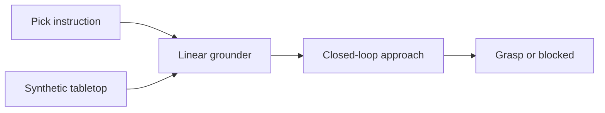

# language-grasp-loop

A CPU-only baseline for language-conditioned grasping on a planar tabletop.

The loop takes a pick command, grounds it to one block with a linear model, then moves a gripper in closed loop. It is a measured starting point for manipulation work, not a camera model and not a vision-language-action foundation model.

## What it does

Supported commands:

- `pick the red block`
- `pick the block left of the blue block`
- `pick the block right of the blue block`
- `pick the nearest block`



The grounder is a 6-feature softmax model trained with SGD. Features are instruction-conditioned geometry: color match, distance, and which side of an anchor the block is on. The controller walks a straight approach and takes one sidestep if another block blocks the path.

## Measured result

Held-out run, committed in [`results/latest.json`](results/latest.json):

| Split | Episodes | Grounding accuracy | Grasp success |
| --- | ---: | ---: | ---: |
| train seed 0, eval seed 1 | 200 | 100% | 97% |

The misses are approaches the sidestep cannot clear. Re-run it with:

```bash
python -m language_grasp --episodes 200
```

## Run the tests

No third-party packages.

```bash
set PYTHONPATH=src
python -m unittest discover -s tests -v
```

On macOS or Linux, use `PYTHONPATH=src` instead of `set`.

GitHub Actions runs the same tests on Python 3.12.

## Scope

In scope: instruction parsing, a learned grounder, closed-loop execution, and a repeatable success rate.

Out of scope: RGB-D perception, 6-DoF grasps, ROS 2, and a real robot. Those belong in a system such as a GraspNet bin-picking stack. This repository is the small loop you can read, test, and extend before that integration.

## Layout

```
src/language_grasp/   scene, parser, model, controller, evaluation
tests/                parser, controller, and held-out grounding
results/latest.json   the 200-episode measurement above
```

## License

MIT
